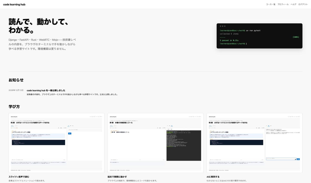

## これはテスト投稿です

フッター修正（画像=スクショのみ、テキスト=実テキスト+リンク）の確認用です。確認後すぐに削除します。

本文の内容に意味はありません。

---

詳しくは[こちら](https://microarchitectures.jp/)をご覧ください。

**Web, プログラミング、Python, Mojoなどをブラウザで動かしながら学べます。**

「code learning hub」では、技術書の内容を実際に動かして理解できます。気楽に覗いてみてください。Mojoは無料で学べます。

[learn.x-clh.net で見る →](https://learn.x-clh.net/)

技術書の内容をブラウザでそのまま動かして学べる学習サイト「code learning hub」も運営しています。よければ[こちら](https://learn.x-clh.net/)からご覧ください。